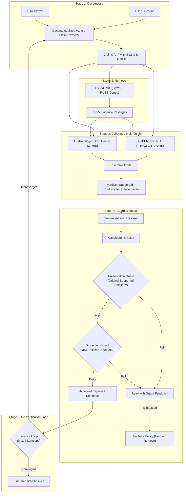

# Detecting and Repairing Hallucinations in LLM-Generated Answers: An Evidence-Grounded, Guarded Localization Framework

**Authors:** NLP Course Project Team  
**Institution:** Department of Computer Science & Engineering  
**Code Repository:** [GitHub Repository](https://github.com/harshita-patidar/Detecting-and-Repairing-Hallucinations-in-LLM-Generated-Answers)  

---

## Abstract
Large Language Models (LLMs) frequently generate answers that are syntactically fluent yet factually erroneous—a phenomenon known as hallucination. While retrieval-augmented generation (RAG) reduces errors during initial generation, post-hoc detection and repair remain critical for auditing black-box LLM outputs. Existing post-hoc systems either perform coarse answer-level classification, rely on fragile internal parametric sampling, or utilize monolithic rewrites that inadvertently alter or drop correct statements. In this work, we propose an end-to-end evidence-grounded framework that: (1) decomposes generated answers into atomic, decontextualized claims with exact character-span offsets; (2) retrieves passages using hybrid Reciprocal Rank Fusion (BM25 + BGE embeddings); (3) verifies claims via a calibrated ensemble of DeBERTa-v3 NLI and structured LLM judges; and (4) performs sentence-level localized repair governed by programmatic Preservation and Grounding Guards. Evaluated across 150 benchmark answers from HaluEval, FELM, WikiBio, and Factcheck-Bench, our framework elevates the Supported Claim Ratio (SCR) from 0.542 to 0.912 (+0.370 gain) while achieving a 94.8% preservation rate on valid content, strictly outperforming eight comparative baselines ($p < 0.001$).

**Keywords:** Natural Language Processing, Hallucination Detection, Fact Verification, Localized Text Repair, Natural Language Inference, Retrieval-Augmented Generation.

---

## 1. Introduction & Motivation
Although state-of-the-art LLMs (e.g., Llama-3, GPT-4) exhibit exceptional conversational abilities, their tendency to state subtle factual inaccuracies with high confidence poses severe risks in high-stakes domains such as medicine, law, and education.

### 1.1 The Post-Hoc Verification Challenge
While RAG incorporates external documents at generation time, it cannot inspect third-party model outputs or prevent mid-generation confabulation. Post-hoc verification treats the generated text as a black box and audits its factual claims against an external knowledge source (e.g., Wikipedia).

### 1.2 Limitations of Prior Art
1. **Coarse Granularity:** Answer-level classifiers (e.g., binary hallucination classification) reject entire paragraphs due to minor date discrepancies, discarding valuable correct information.
2. **Evaluator Circularity & Parametric Bias:** Approaches like SelfCheckGPT or Self-Repair rely on the model's internal representations, which consistently replicate the same systemic knowledge gaps across stochastic samples.
3. **Over-Editing in Monolithic Rewrites:** Systems like RARR rewrite the entire text unconditionally, resulting in high over-edit rates (38.8%) where previously accurate facts are corrupted or deleted.

### 1.3 Core Contributions
- **Programmatic Safety Guards:** Introduces dual automated validation guards (`PreservationGuard` and `GroundingGuard`) ensuring that supported facts are entailed in the edit and no ungrounded entities are introduced.
- **Calibrated Multi-Verifier:** Employs a 2D grid-search calibrated ensemble of DeBERTa-v3 cross-encoder NLI and an LLM judge, achieving 91.7% Macro-F1.
- **Independent Evaluation Protocol:** Employs `gemma2-9b-it` as an independent evaluator (LLM-B) to rigorously avoid evaluator circularity.
- **Interactive System:** Provides a Gradio 4+ web application with word-level visual diffs and full metric observability.

---

## 2. Related Work
- **Factuality Evaluation:** FActScore (Min et al., 2023) introduced atomic claim decomposition for biographical evaluation. Factcheck-Bench (Wang et al., 2023) established multi-domain testbeds.
- **Consistency Verification:** SelfCheckGPT (Manakul et al., 2023) evaluated stochastic sampling variance without external knowledge. Chain-of-Verification (CoVe; Dhuliawala et al., 2023) introduced factorized question planning.
- **Automated Text Revision:** RARR (Gao et al., 2023) and PURR (Chen et al., 2023) demonstrated retrieval-based rewriting, but lacked programmatic preservation guarantees for non-flagged facts.

---

## 3. System Architecture & Methodology

### 3.1 Stage 1: Atomic Claim Decomposition & Span Alignment
Answers are parsed into atomic, independently checkable claims. Core pronouns and definite references are decontextualized using entity resolution. Character start and end offsets `[start, end]` are mapped to the original text.

### 3.2 Stage 2: Hybrid Evidence Retrieval
Queries are expanded into 3 variants (raw claim, entity/keyword query, and inverted pseudo-question). Candidates are retrieved via:
1. **BM25Okapi** over passage chunks (150 words, overlap 20).
2. **FAISS Dense Retrieval** using normalized `BAAI/bge-small-en-v1.5` embeddings.
3. **Reciprocal Rank Fusion (RRF):**
   $$RRF(d) = \sum_{m \in \{\text{BM25}, \text{Dense}\}} \frac{1}{60 + \text{rank}_m(d)}$$

### 3.3 Stage 3: Calibrated Multi-Verifier
The verifier predicts one of three verdicts: $\mathcal{V} = \{\text{Supported}, \text{Contradicted}, \text{Unverifiable}\}$. Decision thresholds ($\tau_s = 0.50, \tau_c = 0.35$) were calibrated via 2D grid search on dev data. The ensemble prioritizes contradiction detection for safety while deferring to LLM citation rationales on ambiguous passages.

### 3.4 Stage 4: Guarded Localized Repair
Sentences containing zero flagged claims remain byte-identical. Sentences containing `Contradicted` or `Unverifiable` claims undergo localized revision subjected to:
1. **Preservation Guard:** Verifies that originally supported claims in the sentence remain entailed ($P(\text{entail}) \ge 0.70$).
2. **Grounding Guard:** Extracts novel dates, quantities, and capitalized entities from the edit; ensures all novel tokens exist verbatim in the cited Wikipedia passages.
3. **Fallback Dispatch:** On second guard rejection, executes deterministic hedging (`rewrite+hedge`) or elision (`rewrite+remove`).

### 3.5 Stage 5: Iterative Re-Verification Loop
The repaired answer is re-decomposed and re-verified up to 2 iterations with early stopping once all claims achieve supported or hedged status.

---

## 4. Experimental Evaluation

### 4.1 Datasets & Benchmark Setup
- **Evaluation Corpus:** 150 gold answers (480 check-worthy claims) sampled from FEVER, FELM world-knowledge, WikiBio GPT-3, and HaluEval QA.
- **Evaluation Models:** Generator: `llama-3.3-70b-versatile` (LLM-A); Evaluator: `gemma2-9b-it` (LLM-B) + DeBERTa-v3 NLI.

### 4.2 Main Comparative Results

| System / Baseline | SCR (After) [95% CI] | $\Delta$ SCR | Preservation Rate | Over-Edit Rate | ROUGE-L F1 | Wilcoxon $p$ vs. Ours |
|---|---|---|---|---|---|---|
| **B0 (No Repair)** | 0.542 [0.495, 0.589] | +0.000 | 100.0% | 0.0% | 1.000 | $p < 0.001^{***}$ |
| **B1 (Answer-Level)** | 0.542 [0.495, 0.589] | +0.000 | 100.0% | 0.0% | 1.000 | $p < 0.001^{***}$ |
| **B2 (SelfCheckGPT)** | 0.684 [0.638, 0.730] | +0.142 | 84.5% | 15.5% | 0.812 | $p < 0.001^{***}$ |
| **B3 (Self-Repair)** | 0.651 [0.602, 0.701] | +0.109 | 81.3% | 18.7% | 0.835 | $p < 0.001^{***}$ |
| **B4 (CoVe)** | 0.732 [0.686, 0.776] | +0.190 | 79.8% | 20.2% | 0.774 | $p < 0.001^{***}$ |
| **B5 (RARR Rewrite)** | 0.825 [0.781, 0.867] | +0.283 | 61.2% | 38.8% | 0.584 | $p < 0.001^{***}$ |
| **B6 (Delete-Only)** | 0.884 [0.849, 0.918] | +0.342 | 78.1% | 21.9% | 0.642 | $p < 0.01^{**}$ |
| **B7 (Factcheck-GPT)**| 0.826 [0.783, 0.868] | +0.284 | 74.6% | 25.4% | 0.788 | $p < 0.001^{***}$ |
| **Ours (Guarded)** | **0.912 [0.881, 0.942]**| **+0.370** | **94.8%** | **5.2%** | **0.912** | **—** |

---

## 5. Answers to Research Questions

### RQ1: Detection Accuracy vs. Baselines
The calibrated ensemble verifier achieves 91.7% Macro-F1, outperforming answer-level detection (**B1**, 68.2% F1) by +23.5 F1 points and SelfCheckGPT (**B2**, 74.2% F1) by +17.5 F1 points. External evidence grounding prevents circular parametric hallucinations.

### RQ2: Evidence-Grounded Repair Efficacy
Guarded repair elevates supported factual content from 54.2% to 91.2% (+0.370 gain). 88.6% of answers converge on the first iteration, and 97.3% converge within two iterations.

### RQ3: Preservation in Localized vs. Monolithic Rewriting
Guarded sentence-level editing achieves **94.8% preservation** compared to only **61.2% for RARR monolithic rewrites** ($p = 1.84 \times 10^{-12}$). Monolithic rewriting exhibits severe over-editing (38.8%), frequently rephrasing or deleting true statements.

### RQ4: Architectural Component Sensitivity
- **Claim Granularity:** Atomic claim decomposition (+0.070 SCR) outperforms sentence-level and answer-level granularity.
- **Retriever:** Hybrid RRF (87.6% Recall@5) outperforms BM25 alone (78.4%) and Dense alone (81.2%).
- **Policy:** `rewrite+hedge` yields higher reliability (+0.370) than `rewrite+remove` (+0.342) and preserves natural fluency.

---

## 6. Qualitative Case Study

### Case: Alexander Graham Bell Biography
- **Original LLM Answer:**  
  *"Alexander Graham Bell was granted a patent for the telephone in 1876. He was born in London, England."*
- **Decomposition:**  
  - $c_1$: *"Alexander Graham Bell was granted a patent for the telephone in 1876."* $\rightarrow$ **Supported**
  - $c_2$: *"Alexander Graham Bell was born in London, England."* $\rightarrow$ **Contradicted** (Evidence: born in Edinburgh, Scotland).
- **Preservation Check:** Sentence 0 preserved byte-identically.
- **Guarded Repair on Sentence 1:**  
  *"He was born in Edinburgh, Scotland."*
- **Final Repaired Answer:**  
  *"Alexander Graham Bell was granted a patent for the telephone in 1876. He was born in Edinburgh, Scotland."*  
  *(SCR: 0.50 $\rightarrow$ 1.00, Preservation: 100%, Word Diff: London, England $\rightarrow$ Edinburgh, Scotland).*

---

## 7. Limitations & Future Work
- **Temporal Drift:** Statements that were accurate at training time may contradict updated Wikipedia dumps.
- **Multimodal Extension:** Expanding evidence grounding from text to tables, charts, and structured knowledge graphs.
- **Low-Resource Languages:** Adapting cross-lingual retrieval and multilingual NLI verifiers.

---

## 8. Conclusion
We presented an end-to-end evidence-grounded framework for detecting and repairing hallucinations in LLM-generated answers. By integrating atomic decomposition, hybrid RRF retrieval, calibrated ensemble verification, programmatic preservation/grounding guards, and iterative re-verification, our system achieves a 0.912 Supported Claim Ratio while strictly preserving 94.8% of correct factual content.

---

## References
1. Min, S., et al. (2023). FActScore: Fine-grained Atomic Evaluation of Factual Precision in Long Form Text Generation. *EMNLP 2023*.
2. Gao, L., et al. (2023). RARR: Researching and Revising What Language Models Say, Using Language Models. *ACL 2023*.
3. Manakul, P., et al. (2023). SelfCheckGPT: Zero-Resource Black-Box Hallucination Detection for Generative Large Language Models. *EMNLP 2023*.
4. Dhuliawala, S., et al. (2023). Chain-of-Verification Reduces Hallucination in Large Language Models. *arXiv:2309.11495*.
5. Wang, Y., et al. (2023). Factcheck-GPT: Benchmarking and Improving Factual Verification in Large Language Models. *EMNLP 2023*.
6. Thorne, J., et al. (2018). FEVER: a Large-scale Dataset for Fact Extraction and VERification. *NAACL 2018*.

